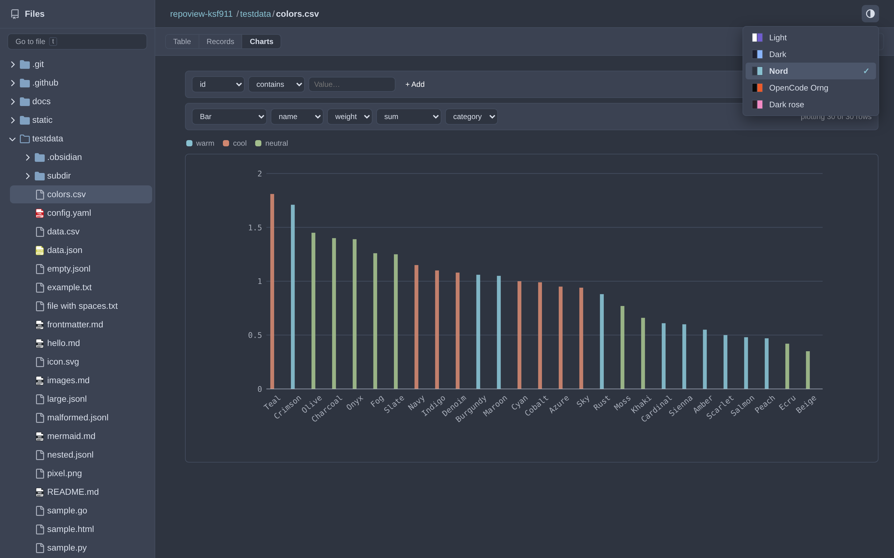
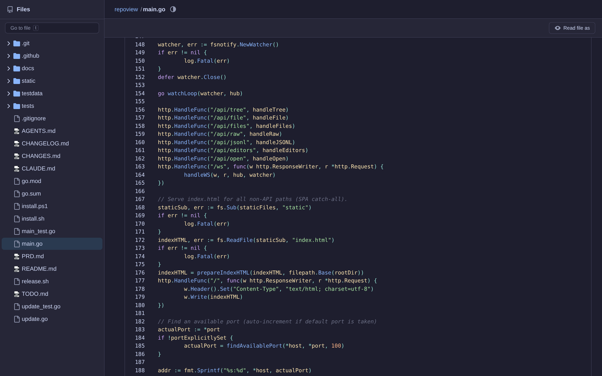
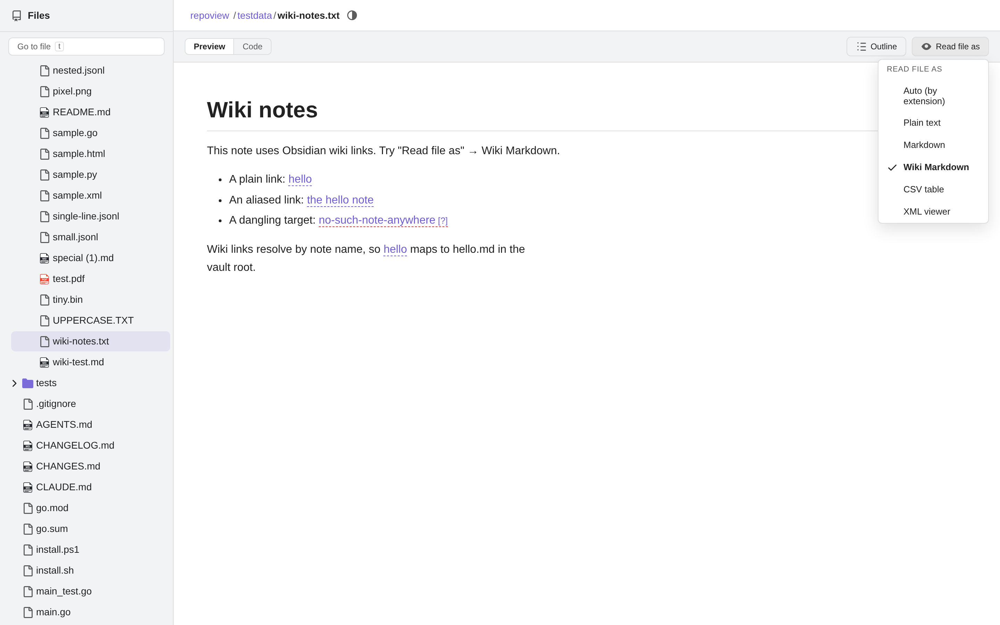
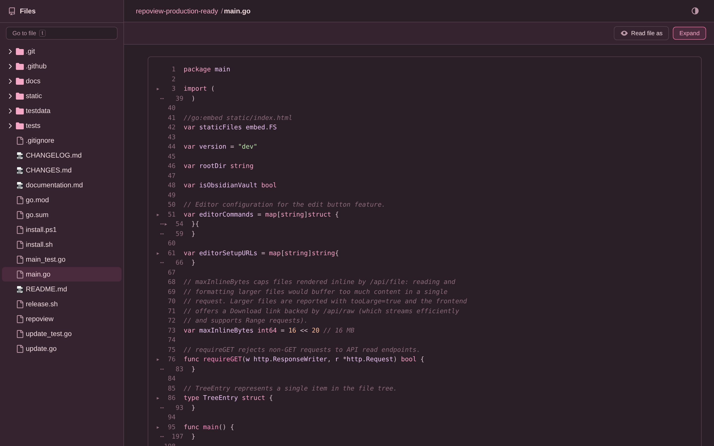

<h1 align="center">
    RepoView
</h1>

A lightweight, single-binary local file viewer that replicates the GitHub UI for browsing files, rendering Markdown or plotting CSV data.

<p align="center">
  <a href="#screenshots">Screenshots</a> -
  <a href="#features">Features</a> -
  <a href="#release-one-liners">Install</a> -
  <a href="#usage">Usage</a> -
  <a href="#development">Development</a> -
  <a href="#license">License and credits</a>
</p>
<p align="center">

</p>

> [!NOTE]
> The demo GIF is from an earlier build — it predates theming,
> CSV charts, the filter toolbar, "Read file as" and collapse & fold. The
> stills in [Screenshots](#screenshots) below are current.

## Screenshots

**CSV Charts, themed.** The Charts view on `colors.csv` — summed weights
per colour name, one bar each, tinted by the colour's category from the
theme's chart palette (legend: warm / cool / neutral), theme picker
open. Series colours resolve through theme variables
(`--rv-chart-1…10`), so the same chart recolours itself under Light /
Dark / Nord / OpenCode Orng.



**Code view, Dark.** Reading the viewer's own `main.go` in the Dark theme:
GitHub-style tree, breadcrumb and Chroma highlighting rendered with theme
classes — never inline colours.



**Read file as.** A plain-text note re-read as Wiki Markdown (`?as=wiki`):
Obsidian `[[wiki links]]` resolve to navigable anchors (broken targets are
marked), with the Read-as menu open.



**Collapse & fold, Dark rose.** Every indent-foldable range of `main.go`
collapsed at once from the file header, the switch reading *Expand*;
single ranges still fold from the gutter caret. Filmed in Dark rose to
show the fold UI holds up under a tinted theme.



## Why

<blockquote>
   <p>
   " I noticed my marketing team, when working with Claude Code and lots of markdown files, pushing commits to GitHub just to read them with a nice UI. That seemed backwards — why should you need to commit and push just to preview your docs? RepoView gives you that same GitHub reading experience locally, instantly. "
   </p>
   <a href="https://github.com/nvquanghuy/repoview">nvquanghuy on the original repository</a>
</blockquote>

## Features

- **GitHub-style UI** — familiar layout with resizable sidebar, breadcrumb navigation, and file tree
- **Markdown rendering** — GitHub-Flavored Markdown via goldmark (tables, task lists, code blocks)
- **Five-way theming** — Light (Obsidian palette), Dark (Catppuccin-inspired), Dark rose (pink-shaded Dark), Nord and OpenCode Orng colorways from a picker in the header, with theme-aware code tokens and chart palettes; the choice persists per browser. Add your own theme per [Theming & custom themes](#theming--custom-themes)
- **Read file as** — re-render any text file as plain text, Markdown, Wiki Markdown (Obsidian wiki links expand even outside a vault), a CSV table, or XML from a dropdown in the file header; plain `.txt` files open in a clean reading view with soft-wrap and line-number toggles
- **CSV filter toolbar** — per-column operators (contains, equals, regex, greater, less, empty), match all or any combination, removable filter chips (click the chip itself) and a live "Showing X of Y rows" count
- **CSV column sorting** — click a table header to cycle ascending → descending → off, numeric-aware (weights sort as numbers), `aria-sort` state, and every filter/sort/chart control carries a descriptive label + tooltip
- **CSV charts** — a Charts view beside the table with hand-rolled SVG visuals, no dependencies: bar, horizontal bar, stacked bar, histogram, line, area, scatter, bubble, heat map, pie and donut; choose the X column, numeric measure and aggregation (sum, avg, min, max, count), group by a colour column where it makes sense, and charts refresh live with the active row filters. Series colours follow the active theme (`--rv-chart-1…10` palettes), and a dashed accent guideline tracks the pointer across the plot while you read values
- **XML viewer** — `.xml` files get Tree/Table/Code views with client-side element filtering via tag globs (`book*`), attribute matchers (`book@id=x`), text search and XPath (`//book[@genre='web']`)
- **Fuzzy file search** — press `t` to open a "Go to file" modal with fuzzy matching
- **Live reload** — WebSocket-based file watching with fsnotify; changes appear instantly
- **Single binary** — all HTML/CSS/JS embedded via `go:embed`, no external dependencies at runtime
- **Lazy-loading tree** — sidebar fetches directory contents on demand for fast startup on large repos
- **Auto-update** — checks for updates daily and can self-update with `repoview update`

## Install

### Release one-liners

Once a version is published via the tag release flow (below):

```bash
curl -fsSL https://raw.githubusercontent.com/kittystrikeforce911/repoview-ksf911/master/install.sh | bash
```

Downloads the latest release binary for your OS/architecture to `~/.local/bin`.

```powershell
irm https://raw.githubusercontent.com/kittystrikeforce911/repoview-ksf911/master/install.ps1 | iex
```

Downloads the latest release binary to `%LOCALAPPDATA%\Programs\repoview`.

### From source

```bash
git clone https://github.com/kittystrikeforce911/repoview-ksf911.git
cd repoview-ksf911
go build -o repoview .
```

Requires a Go toolchain (see `go.mod` for the floor). The binary is
self-contained: all markup, styles and scripts are embedded at build time,
so nothing else is needed at runtime.

### Uninstall

Both helpers remove the binary (and any pending self-update leftover)
plus RepoView's update state:

```bash
curl -fsSL https://raw.githubusercontent.com/kittystrikeforce911/repoview-ksf911/master/uninstall.sh | bash
```

The Windows one also drops the install directory from your user PATH if
it was added after installing:

```powershell
irm https://raw.githubusercontent.com/kittystrikeforce911/repoview-ksf911/master/uninstall.ps1 | iex
```

Install directories are only removed when the uninstall leaves them
empty, so nothing belonging to other tools is touched. From-source
installs were never laid down by an installer — delete the binary you
built.

## Usage

```bash
cd ~/projects/myrepo && repoview
```

This starts a local server at http://localhost:7777 and opens your browser to browse the repo with a GitHub-style UI.

### Options

```bash
repoview                    # serve current directory on http://localhost:7777
repoview /path/to/dir       # serve a specific directory
repoview --port 3000        # use a custom port
repoview --host 0.0.0.0     # expose to the network (default: 127.0.0.1)
repoview --no-browser       # don't auto-open the browser
repoview --version          # print version and exit
repoview update             # download and install the latest version
repoview update --check     # check for updates without installing
```

### Flags

| Flag | Default | Description |
|------|---------|-------------|
| `--host` | `127.0.0.1` | Host/IP to bind to |
| `--port` | `7777` | Port to serve on |
| `--no-browser` | `false` | Don't auto-open the browser on startup |
| `--version` | | Print version and exit |

### Updating

RepoView checks for updates automatically once per day on startup. If a new version is available, you'll see a notification in the terminal.

To manually update:

```bash
repoview update           # download and install the latest version
repoview update --check   # check for updates without installing
```

The update command downloads the latest release from GitHub, shows release notes, and replaces the current binary.

> The update check reads the GitHub Releases API; until a tagged release
> is published, it resolves to "no release" and stays silent, and
> `repoview update` reports the missing release instead of downloading
> anything.

### Access from other devices

Folder viewing is meant to live on your own network. Phones, tablets and
other machines on the same LAN can browse the repository served by any
machine running RepoView with `--host 0.0.0.0`:

```bash
repoview --host 0.0.0.0              # reachable by every device on the LAN
```

Then open `http://<server-ip>:7777` on the other device. The whole app
(browser UI, `/api/*` reads and the live-reload WebSocket) uses the address
you connect to, so no extra setup is needed. The WebSocket upgrade is
accepted from the same host you are browsing through — including a LAN IP —
and refused for pages served from foreign hosts; non-browser clients that
send no `Origin` header are unaffected.

## Theming & custom themes

RepoView ships five built-in themes

| Nickname | Notes | Source |
| ---: | --- | --- |
| Light | Harsh on the eyes; It's a light theme by nature. | Obsidian's default light |
| Dark | Recommended for daily and prolonged usage. | Catppuccin-based. From the original repository |
| Dark Rose | A pink take on the Dark theme. Recommended for one-shot sessions | Dark theme |
| Nord | Yet another Nord theme. Alternative to Dark | Official ramp |
| OpenCode Orng | The contrast can have negative impact in long lasting sessions. Very industrial color combination | - |

> [!TIP] 
> Everything is CSS-variable driven and client-side; the server never hard-codes a color.

### How the theme system works

| Piece | Where (`static/index.html` unless noted) | What it does |
|---|---|---|
| `[data-theme="…"]` blocks | lines ~10, ~60, ~112, ~163, ~215 | Five blocks × **44 `--rv-*` variables each** — page shell colors, 9 chroma token colors, 10 chart series colors |
| Boot IIFE | ~2366–2376 | Reads `localStorage("rv-theme")` (validated against the allowlist), falls back to `prefers-color-scheme` (dark → Dark, else Light), sets `data-theme` on `<html>` before first paint — no flash |
| Theme picker | `THEMES` array ~2499 + `setTheme()` / `renderThemeMenu()` ~2520+ | Builds the menu (id, label, two-color swatch chips); switching sets the attribute, persists to `localStorage`, and remaps Mermaid (any non-`light` id renders as `dark`) |
| Chroma code tokens | `main.go:710–712` | The file server emits **class names only** (`chromahtml.WithClasses(true)`, `WithLineNumbers(true)`, inline `.ln` variant) — token colors resolve through `--rv-code-*`, so one var block restyles every lexed file type |
| Charts | SVG chart engine | Series fills are written as `style="fill: var(--rv-chart-N)"`, so all 11 chart shapes re-color per theme automatically |

### Custom themes — how to add one (format & structure)

Adding a theme touches exactly two files' worth of edit in
`static/index.html` (the UI is embedded into the binary via `go:embed`,
so rebuild or `go run .` to see it):

1. **Choose the `id`** — a lowercase slug used as the `data-theme`
   attribute value and in `localStorage`, e.g. `dracula`.

2. **Append one `[data-theme="dracula"]` block** after the last theme
   block. The contract is **44 variables** — all five built-in blocks are
   structurally identical, and every surface (tree, markdown, code
   tokens, CSV charts, overlays, scrollbars) hangs off them:

   | Group | Variables |
   |---|---|
   | Page shell (25) | `--rv-bg`, `--rv-bg-secondary`, `--rv-bg-tertiary`, `--rv-bg-hover`, `--rv-bg-active`, `--rv-border`, `--rv-border-active`, `--rv-text`, `--rv-text-secondary`, `--rv-text-tertiary`, `--rv-link`, `--rv-icon-folder`, `--rv-resize-handle`, `--rv-scrollbar-thumb`, `--rv-scrollbar-thumb-hover`, `--rv-overlay`, `--rv-shadow`, `--rv-shadow-strong`, `--rv-error-bg`, `--rv-error-border`, `--rv-error-text`, `--rv-error-btn-hover`, `--rv-warning-bg`, `--rv-warning-border`, `--rv-warning-text` |
   | Code (chroma) tokens (9) | `--rv-code-key` (keywords), `--rv-code-str` (strings), `--rv-code-num` (numbers), `--rv-code-com` (comments), `--rv-code-fn` (functions), `--rv-code-cls` (classes/types), `--rv-code-tag` (tags), `--rv-code-attr` (attributes), `--rv-code-op` (operators/punctuation) |
   | Chart series (10) | `--rv-chart-1` … `--rv-chart-10` — sequential assignment to repeated series (line/area/scatter/dot colors, heat-map rows). Define **all ten**; a missing var renders its series with transparent fills |

   Each block also sets `color-scheme: dark` (or `light`), which drives
   native scrollbars and form controls. Worked example (values illustrative
   — adapt to the target palette):
   <details>
   <summary>Show code</summary>

   ```css
   [data-theme="dracula"] {
       color-scheme: dark;
       /* Page shell */
       --rv-bg: #282a36;
       --rv-bg-secondary: #21222c;
       --rv-bg-tertiary: #1e1f27;
       --rv-bg-hover: #343746;
       --rv-bg-active: #44475a40;
       --rv-border: #44475a;
       --rv-border-active: #bd93f9;
       --rv-text: #f8f8f2;
       --rv-text-secondary: #a0a2b5;
       --rv-text-tertiary: #6272a4;
       --rv-link: #bd93f9;
       --rv-icon-folder: #ff79c6;
       --rv-resize-handle: #bd93f940;
       --rv-scrollbar-thumb: #44475a;
       --rv-scrollbar-thumb-hover: #6272a4;
       --rv-overlay: #00000060;
       --rv-shadow: rgba(0, 0, 0, 0.30);
       --rv-shadow-strong: rgba(0, 0, 0, 0.45);
       --rv-error-bg: #42283a;
       --rv-error-border: #ff5555;
       --rv-error-text: #ff6e6e;
       --rv-error-btn-hover: #c74c4c;
       --rv-warning-bg: #3f3a2e;
       --rv-warning-border: #f1fa8c;
       --rv-warning-text: #e6d97a;
       /* Chroma tokens */
       --rv-code-key: #ff79c6;
       --rv-code-str: #f1fa8c;
       --rv-code-num: #bd93f9;
       --rv-code-com: #6272a4;
       --rv-code-fn: #50fa7b;
       --rv-code-cls: #8be9fd;
       --rv-code-tag: #ff79c6;
       --rv-code-attr: #50fa7b;
       --rv-code-op: #f8f8f2;
       /* Chart palette */
       --rv-chart-1: #bd93f9;
       --rv-chart-2: #50fa7b;
       --rv-chart-3: #ffb86c;
       --rv-chart-4: #ff5555;
       --rv-chart-5: #8be9fd;
       --rv-chart-6: #f1fa8c;
       --rv-chart-7: #ff79c6;
       --rv-chart-8: #6272a4;
       --rv-chart-9: #9580ff;
       --rv-chart-10: #b4befe;
   }
   ```

</details>

3. **Register it in the picker** — two spots in the script blocks:
   ```js
   // boot allowlist (~2369): saved themes outside this list fall back
   var THEMES = ['light', 'dark', 'nord', 'opencode', 'dracula'];
   // picker menu (~2499): entries render as menu rows
   var THEMES = [
       { id: 'light',    label: 'Light',         swatch: ['#ffffff', '#705dcf'] },
       { id: 'dracula',  label: 'Dracula',       swatch: ['#282a36', '#bd93f9'] },
       ...
   ];
   ```
   `swatch` is `[background, accent]` — the two mini-color-chips shown in
   the menu before the theme is applied. These preview hexes are the one
   intentional duplication in the system.

4. **Verify**: open the theme menu (the new row appears), switch to it,
   and check tree, a markdown file, a code file (token colors), a CSV
   Charts view (all 10 palette entries distinct) and a save/empty-warn
   state (error/warning colors). The choice persists across reloads via
   `localStorage`.

Structure notes learned by shipping the system:

- **Same-specificity overrides must come later in source order.** The
  `@media (max-width: 768px)` block sits *before* the theme section, so
  any mobile override of a theme-section rule added inside that early
  block is silently ignored — repeat the override after the base rule
  instead (this bit the theme-menu positioning fix, `2eea88a`).
- Mermaid diagrams don't get their own palette — the picker only maps
  `light` vs everything else to Mermaid's `default`/`dark`.
- `prefers-color-scheme` picks only the built-ins; custom ids are always
  reachable through the menu (or `localStorage`).
- A shipped live variant to crib from: **`rose` (Dark rose)** is the `dark`
  block hue-rotated into pink — same structure, same contrast levels, and
  a good starting point for any tinted take on an existing theme.
- The `fold-switch` header button (code-fold Collapse/Expand) shares the
  standalone action-button rule set with `.outline-btn` — declare new
  header action styling there to keep every bar button uniform.

## API

| Endpoint | Description |
|----------|-------------|
| `GET /api/tree?path=` | Returns immediate children of a directory as JSON |
| `GET /api/file?path=` | Returns rendered file content as JSON. Flags: `isMarkdown`, `isCSV`, `isSVG`, `isHTML`, `isXML` (+ `rawXML` for the DOM-parseable source), `isPDF`, `isJSONL`, `isBinary`, `tooLarge` (file exceeds the 16 MB inline cap → Download via `/api/raw`), `content` (rendered HTML), `rawContent` (code view), `rawCSV`, `rawSVG`, `mimeType`, `size`. Optional `&as=txt\|md\|csv\|xml\|wiki` overrides how the file renders ("Read file as" menu; `as=wiki` renders Markdown and expands Obsidian wiki links even outside an `.obsidian` vault) |
| `GET /api/raw?path=` | Serves the original file bytes for inline display and downloads (supports Range requests) |
| `GET /api/files` | Returns a flat list of all file paths (uses `git ls-files` when available) |
| `GET /api/jsonl?path=&page=&pageSize=` | Returns a page of JSONL records as pretty-printed JSON (max 100/page) |
| `GET /api/editors` | Returns available editors for the "Open in editor" feature |
| `POST /api/open?path=&editor=` | Opens a file in a configured editor (`vscode`, `cursor`, `sublime`, `zed`) |
| `WS /ws` | WebSocket for file change notifications (same-origin only) |

All read-only endpoints accept `GET`/`HEAD` only and answer `405` otherwise.

## Known limitations

- **Mermaid diagrams load from the jsdelivr CDN** — in an offline or
  air-gapped environment, diagram rendering fails with a JS console error
  while the Markdown text itself stays readable. (Candidate follow-up:
  vendor the script into `static/` or lazy-load it with a fallback
  notice.)

## Development

```bash
# Run locally
go run . /path/to/dir

# Run tests
go test -v ./...

# Frontend (Playwright browser) tests
cd tests && npm test

# Build
go build -o repoview .
```

### Setting up a minimal Debian machine

The project is developed against a full toolchain. A fresh **minimal Debian**
install has none of it — no version managers, no distribution Go — so set it
up manually:

```bash
# Base tooling
sudo apt-get update && sudo apt-get install -y \
    git curl ca-certificates build-essential unzip xz-utils

# Go — official tarball (set GOVER to the current release from go.dev/dl)
GOVER=1.27.3
curl -L "https://go.dev/dl/go${GOVER}.linux-amd64.tar.gz" \
    | sudo tar -C /usr/local -xz
echo 'export PATH=$PATH:/usr/local/go/bin:$HOME/go/bin' >> ~/.profile

# Node.js LTS — official tarball into ~/.local/opt (current from nodejs.org)
NODEVER=v22.23.4
mkdir -p ~/.local/opt
curl -L "https://nodejs.org/dist/${NODEVER}/node-${NODEVER}-linux-x64.tar.xz" \
    | tar -C ~/.local/opt -xJ
echo "export PATH=$PATH:$HOME/.local/opt/node-${NODEVER}-linux-x64/bin" >> ~/.profile
```

Then in a new checkout, and for every gate run:

```bash
# Backend gate (no Node needed at all)
go build -o repoview . && go vet ./... && go test ./... && gofmt -l .

# Frontend / Playwright (one-time setup)
cd tests && npm ci
npx playwright install --with-deps chromium

# Frontend gate
npm test
```

Notes:
- Playwright's webServer boots `go run ..` on port 3123 with a 60 s timeout.
  A cold compile can still be exceeded: build and serve the binary yourself
  (`go build -o /tmp/repoview .. && /tmp/repoview -port 3123 -no-browser
  ../testdata`) and the suite reuses the already-running server.
- The plain-text view of `static/index.html` re-embeds on every `go build`;
  no Node step is required for backend-only work.

### Releasing

```bash
./release.sh          # bump patch: v0.1.0 → v0.1.1
./release.sh minor    # bump minor: v0.1.0 → v0.2.0
./release.sh major    # bump major: v0.1.0 → v1.0.0
./release.sh 2.0.0    # explicit version
```

This updates `CHANGELOG.md`, commits, tags, and pushes the commit and tag to
the fork (`git push` + `git push fork <tag>`). GitHub Actions builds the
release binaries from the tagged commit.

### Project Structure

```
main.go                # Server, API handlers, WebSocket hub, file watchers
update.go              # update subcommand + GitHub release checks
main_test.go           # Backend unit and integration tests
static/index.html      # Single-page frontend (embedded at build time)
static/index_test.html # Frontend test harness
tests/                 # Playwright browser suite
testdata/              # Sample files used by tests
install.sh/.ps1        # Release asset installers (macOS/Linux, Windows)
uninstall.sh/.ps1      # Removal helpers mirroring the installer targets
release.sh             # Version bump + tag + push helper
CHANGES.md             # Per-commit engineering record (this branch)
CHANGELOG.md           # Per-release user-facing notes
```

## License

MIT — "A short and simple permissive license with conditions only
requiring preservation of copyright and license notices."
([choosealicense.com/licenses/mit](https://choosealicense.com/licenses/mit/))

| Permissions | Conditions | Limitations |
|-------------|------------|-------------|
| ✓ Commercial use · ✓ Distribution · ✓ Modification · ✓ Private use | ⓘ License and copyright notice | ✕ Liability · ✕ Warranty |

Based on [nvquanghuy/repoview](https://github.com/nvquanghuy/repoview) v0.17.0, continued in this repository.
